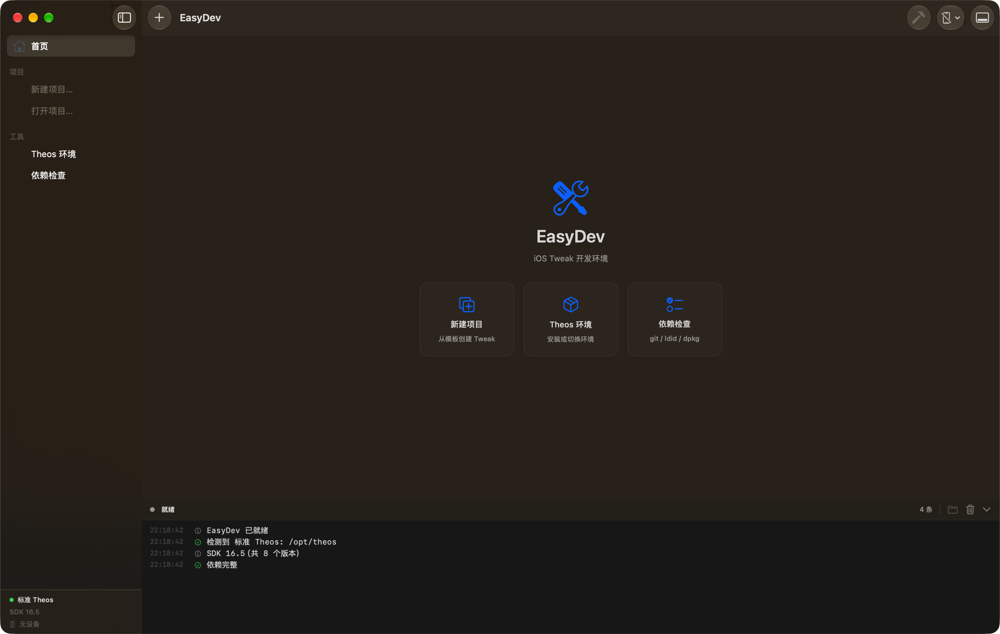
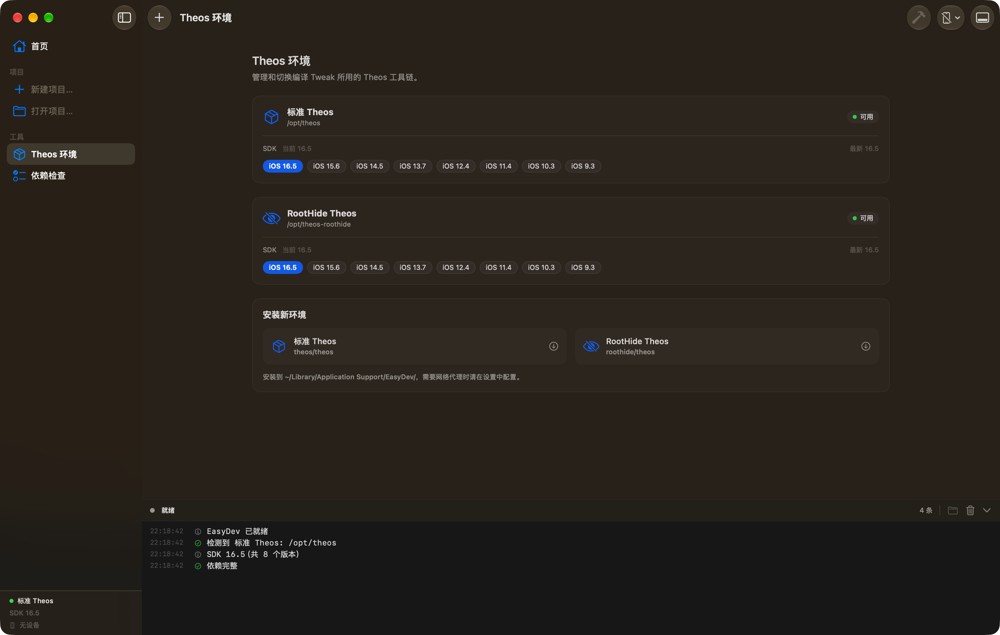
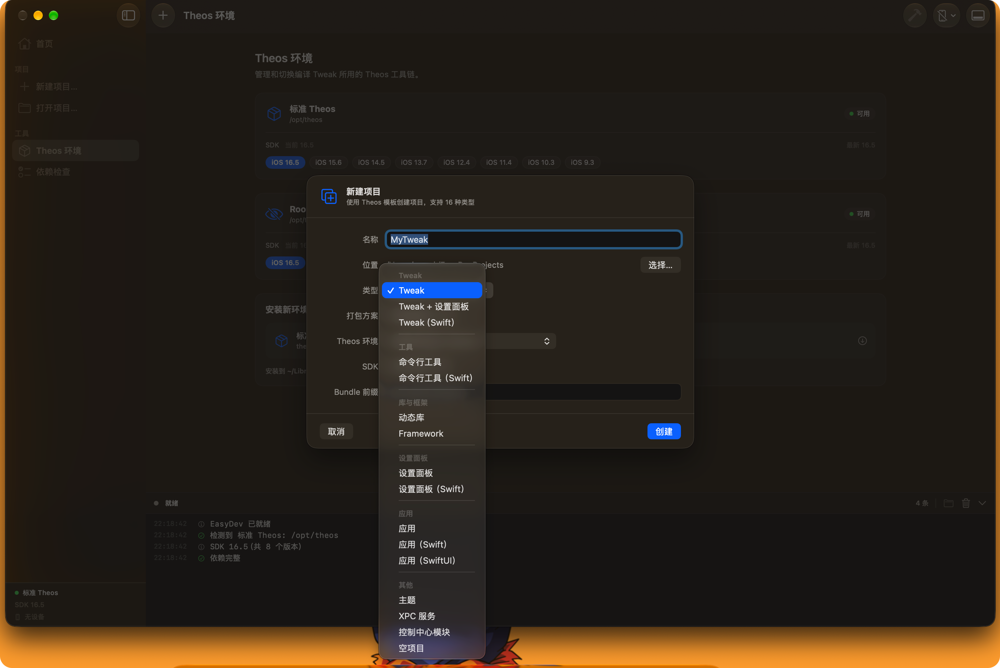

# EasyDev

macOS 上的 iOS Tweak 开发工具，基于 [Theos](https://github.com/theos/theos) 工具链。

通过图形界面完成环境管理、项目创建、代码编辑、编译打包，省去命令行配置。



### 环境管理



### 新建项目




## 目录

- [功能](#功能)
- [系统要求](#系统要求)
- [安装](#安装)
- [使用](#使用)
  - [环境管理](#1-环境管理)
  - [依赖检查](#2-依赖检查)
  - [新建项目](#3-新建项目)
  - [打开已有项目](#4-打开已有项目)
  - [编辑代码](#5-编辑代码)
  - [构建项目](#6-构建项目)
- [支持的模板](#支持的模板)
- [打包方案](#打包方案)
- [常见问题](#常见问题)
- [已知限制](#已知限制)
- [许可证](#许可证)

## 功能

- 自动检测系统中的 Theos 环境，支持标准版与 RootHide 版共存
- 一键安装 Theos（标准 / RootHide），从 GitHub 克隆并初始化子模块
- 检查编译依赖（git、make、ldid、dpkg、perl、brew）并显示版本
- 调用 Theos 官方 `nic.pl` 生成项目，支持全部 16 种内置模板
- 内置代码编辑器，提供 Logos / Objective-C / C++ 语法高亮与关键字补全
- 图形化构建，实时输出日志，自动定位构建产物
- 每个环境可独立选择编译所用的 iOS SDK 版本

## 系统要求

| 项目 | 要求 |
| --- | --- |
| 系统 | macOS 14.6 或更高 |
| 架构 | Apple Silicon（arm64）或 Intel |
| Theos | 标准版 / RootHide 版，二选一或都装 |
| 依赖 | git、make、ldid、dpkg、perl |

依赖可通过 Homebrew 安装：

```bash
brew install ldid dpkg
```

## 安装

### 从源码构建

```bash
git clone https://github.com/Mac-XK/EasyDev.git
cd EasyDev
open EasyDev.xcodeproj
```

在 Xcode 中选择 `EasyDev` scheme，按下 `⌘B` 编译，`⌘R` 运行。

编译产物位于 Xcode 的 Products 目录，可直接拖入「应用程序」文件夹。

## 使用

### 1. 环境管理

侧边栏进入「Theos 环境」。

应用会扫描以下路径并按顺序匹配：

```
$THEOS 环境变量
/opt/theos
/opt/roothide-theos
/opt/theos-roothide
~/theos
~/Library/Application Support/EasyDev/theos
~/Library/Application Support/EasyDev/roothide-theos
```

有效性判断标准：目录下同时存在 `makefiles/` 与 `bin/nic.pl`。

检测到环境后会显示该环境下 `sdks/` 中所有 `iPhoneOS*.sdk` 的版本。点击任一 SDK 标签即可切换，选择结果按环境路径保存，重启应用后保持。

安装新环境：

1. 点击「标准 Theos」或「RootHide Theos」
2. 应用执行 `git clone --recursive` 与 `git submodule update --init --recursive`
3. 过程日志输出在底部面板
4. 完成后自动刷新环境列表

默认安装位置：

```
~/Library/Application Support/EasyDev/theos
~/Library/Application Support/EasyDev/roothide-theos
```

安装过程不会修改 Xcode 或系统目录，删除应用时这些文件仍会保留。

### 2. 依赖检查

侧边栏进入「依赖检查」。

显示六个工具的可执行文件路径与版本：

```
git      克隆 Theos 与子模块
make     驱动 Theos 构建
ldid     重签名 dylib
dpkg     打包 deb
perl     Logos 预处理器依赖
brew     安装缺失依赖
```

缺失的必需依赖会以红色标记，并在底部提示数量。

### 3. 新建项目

点击侧边栏「新建项目…」或按 `⌘N`。

| 字段 | 说明 |
| --- | --- |
| 名称 | 项目名，同时作为 dylib 文件名 |
| 位置 | 项目存放目录，默认 `~/EasyDevProjects` |
| 类型 | Theos 模板，共 16 种 |
| 打包方案 | Rootful / Rootless / RootHide |
| Theos 环境 | 使用哪个 Theos 工具链 |
| SDK | 编译使用的 iOS SDK 版本 |
| Bundle 前缀 | 生成 control 文件中的 Package 字段 |

创建流程：

1. 调用所选环境的 `bin/nic.pl` 生成模板
2. 将 Makefile 中的 `TARGET` 替换为所选 SDK，部署版本固定为 15.0
3. 若类型为 Tweak，将模板自带的示例源码替换为可用的 `%hook UIApplication` 骨架
4. 补全 MobileSubstrate 过滤器（若模板未生成）
5. 加入侧边栏并进入编辑器

### 4. 打开已有项目

点击侧边栏「打开项目…」，选择包含 `Makefile` 的目录。

应用会根据目录内容自动判断语言类型：

```
.xmi / .xm  -> Logos
.swift      -> Swift
.mm         -> Objective-C++
其他        -> Objective-C
```

### 5. 编辑代码

编辑器基于 `NSTextView`，主要能力：

**语法高亮**

| 元素 | 颜色 |
| --- | --- |
| Logos 关键字（`%hook` `%end` `%ctor` `%orig` 等） | 粉色加粗 |
| Objective-C 关键字（`@interface` `@property` 等） | 靛蓝加粗 |
| C / C++ 关键字 | 紫色 |
| 字符串 | 红色 |
| 注释 | 灰色 |
| 数字 | 蓝色 |
| 预处理指令 | 棕色加粗 |

**代码补全**

输入内容后自动弹出候选面板，也可用方向键选择：

| 按键 | 动作 |
| --- | --- |
| 上 / 下 | 切换候选 |
| Enter / Tab | 插入 |
| Esc | 关闭 |

匹配不区分大小写，例如 `ns` 可匹配 `NSObject`、`NSString`、`NSLog`。

片段类候选插入整段模板：

| 触发 | 插入内容 |
| --- | --- |
| `hook` | `%hook ClassName` 加 `%end` |
| `ctor` | `%ctor { %init; }` |
| `group` | `%group GroupName` 加 `%end` |
| `subclass` | `%subclass Class : Super` 加 `%end` |
| `property` | `%property` 声明 |
| `import` | `#import <Foundation/Foundation.h>` |

插入后占位内容会被选中，直接输入即可替换。

文件修改后 0.7 秒自动保存，切换文件或关闭编辑器前也会保存。

### 6. 构建项目

选中项目后按 `⌘B`，或点击工具栏锤子按钮。

构建实际执行的命令等价于：

```bash
make package \
  THEOS=<环境路径> \
  ARCHS="arm64 arm64e" \
  TARGET=iphone:clang:<所选SDK>:15.0 \
  THEOS_PACKAGE_SCHEME=<打包方案>
```

构建过程中：

- 日志实时输出到底部面板，`error:` 红色、`warning:` 橙色、`==>` 蓝色
- 工具栏按钮切换为停止，可中断构建
- 构建成功后自动列出产物文件名

产物位置：

```
<项目目录>/packages/*.deb
<项目目录>/.theos/obj/debug/*.dylib
```

点击日志栏右上角的文件夹按钮，可在 Finder 中直接定位产物。

## 支持的模板

新建项目时可选择以下 16 种 Theos 模板：

| 分组 | 模板 |
| --- | --- |
| Tweak | `iphone/tweak`、`iphone/tweak_with_simple_preferences`、`iphone/tweak_swift` |
| 工具 | `iphone/tool`、`iphone/tool_swift` |
| 库与框架 | `iphone/library`、`iphone/framework` |
| 设置面板 | `iphone/preference_bundle`、`iphone/preference_bundle_swift` |
| 应用 | `iphone/application_modern`、`iphone/application_swift_modern`、`iphone/application_swiftui` |
| 其他 | `iphone/theme`、`iphone/xpc_service_modern`、`iphone/control_center_module-11up`、`iphone/null` |

## 打包方案

| 方案 | 标准 Theos | RootHide Theos | 安装路径 |
| --- | --- | --- | --- |
| Rootful | 支持 | 支持 | `/Library/MobileSubstrate/DynamicLibraries` |
| Rootless | 支持 | 支持 | `/var/jb/Library/MobileSubstrate/DynamicLibraries` |
| RootHide | 不支持 | 支持 | `/var/jb/Library/MobileSubstrate/DynamicLibraries` |

选择当前环境不支持的方案时，构建会直接报错，不会执行到中途。

TrollStore 不属于 Theos 的打包方案，因此未列入选项。

## 常见问题

### 打开应用后提示「未检测到 Theos 环境」

确认 Theos 已安装，且目录下同时存在 `makefiles/` 与 `bin/nic.pl`。

若安装在非标准路径，可通过环境变量指定：

```bash
launchctl setenv THEOS /your/path/to/theos
```

然后重启应用。

### 检测到了环境但 SDK 列表为空

检查 `<Theos>/sdks/` 下是否存在 `iPhoneOS*.sdk` 目录。

SDK 可从 [theos/sdks](https://github.com/theos/sdks) 下载，或从 Xcode 中提取：

```bash
cp -R "/Applications/Xcode.app/Contents/Developer/Platforms/iPhoneOS.platform/Developer/SDKs/iPhoneOS.sdk" \
      "<Theos>/sdks/iPhoneOS<版本号>.sdk"
```

### 构建报错 `ldid: command not found`

应用启动的构建进程使用固定 PATH。确认 `ldid` 位于以下任一位置：

```
/opt/homebrew/bin/ldid
/usr/local/bin/ldid
```

### 构建报错 `MSHookMessageEx` 未声明

部分 Theos 与 SDK 组合不会自动引入 substrate 头文件。在源码中添加：

```objc
#import <objc/runtime.h>
#import <substrate.h>
```

### 创建 Tweak 项目时终端出现 `Use of uninitialized value`

`nic.pl` 会询问「安装时终止哪些应用」，应用以空输入调用它，因此该提示会使用默认值并打印这条警告。不影响项目生成。

### 安装 Theos 很慢或卡住

克隆过程需要访问 GitHub。如在受限网络中，可先配置系统代理，或手动克隆后将路径加入检测列表。

### Dock 图标未更新

系统图标缓存问题，执行：

```bash
killall Dock
```

## 已知限制

- 暂未实现设备检测与 `make install` 部署
- 暂未实现 IPA 注入与重签名
- 暂未集成 LLDB 调试
- 项目列表不会持久化，重启应用后需要重新打开
- Swift 模板可正常生成与编译，但编辑器仅为 Swift 提供基础高亮，没有 Swift 专用补全

## 许可证

MIT
